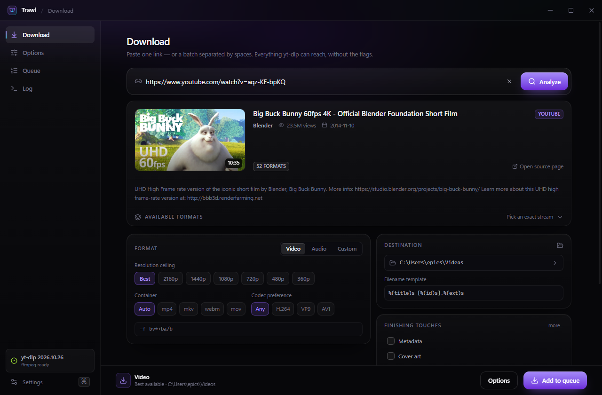
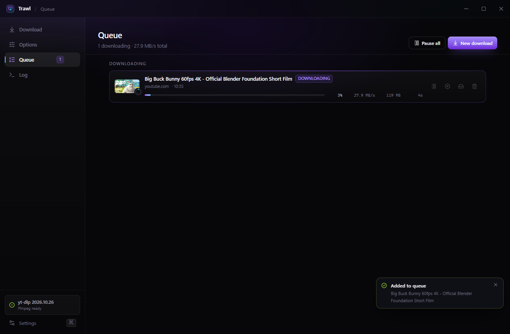
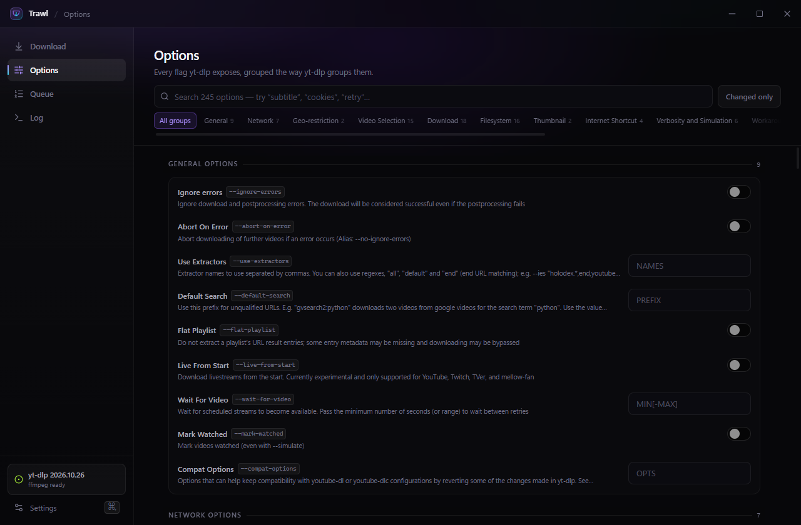

<div align="center">


# Trawl

**A comprehensive, genuinely nice desktop front end for yt-dlp.**

[](https://github.com/epicshawty/trawl/releases)
[](https://github.com/epicshawty/trawl/actions)
[](LICENSE)
[](#install)
[](https://github.com/yt-dlp/yt-dlp)
[](https://electronjs.org)



</div>

## What it is

Trawl puts yt-dlp behind an interface that doesn't require reading `--help`. The registry is generated from yt-dlp 2026.10.26's 245 flags — every one that means something outside a terminal is in there.

- **Analyze any link** — thumbnails, chapters, subtitle tracks, and all 52 formats for a video, in one request.
- **Format composer** — resolution ceiling, container, codec, fps, or a raw format expression. Audio mode extracts and converts with ffmpeg.
- **Real queue** — concurrency, pause/resume, live percent, speed and ETA, per-stream progress, retry, reveal in folder.
- **Everything else** — cookies from any browser, SponsorBlock, chapters, embedding, time ranges, proxies, rate limits, aria2c, presets that save your whole configuration.
- **Honest** — the Log tab shows the exact `yt-dlp` command it ran, character for character.

<div align="center">
<table>
<tr>
<td></td>
<td></td>
</tr>
<tr>
<td align="center"><sub>Live queue with per-stream progress</sub></td>
<td align="center"><sub>Every option, grouped the way yt-dlp groups them</sub></td>
</tr>
</table>
</div>

## Install

Download the latest build for your platform from [Releases](https://github.com/epicshawty/trawl/releases):

| Platform | File |
| --- | --- |
| Windows 10/11 | `Trawl-x.y.z-win-x64.exe` |
| macOS (Intel / Apple Silicon) | `Trawl-x.y.z-mac-x64.dmg` · `Trawl-x.y.z-mac-arm64.dmg` |
| Linux | `Trawl-x.y.z-linux-x86_64.AppImage` · `.deb` |

Trawl finds `yt-dlp` on your `PATH`; if it isn't there, **Settings → Get yt-dlp** downloads the official binary into the app's data folder.

**Portable:** create a file named `portable` next to the executable and all state lives in `data/` beside it instead of in AppData — see [usage](docs/USAGE.md#portable-mode).

**ffmpeg** is required for muxing, converting and embedding. For the best YouTube coverage, also install [Deno](https://deno.com) — yt-dlp uses it as a JavaScript runtime and some formats are unavailable without it.

## Build

```bash
npm ci
npm run build
npm run dist          # current platform → release/
```

`npm run dev` runs Vite with hot reload against a live Electron window. `npm run gen:options` regenerates the option registry from `scripts/fixtures/yt-dlp-help.txt`.

## Documentation

- [Usage](docs/USAGE.md) — the short version.
- [Changelog](CHANGELOG.md) — semver, tags drive releases.

## License

[AGPL-3.0-or-later](LICENSE). If you run a modified Trawl as a network service, you must offer users its source. yt-dlp itself is public domain (Unlicense); Electron, React and every other dependency here is permissively licensed.
